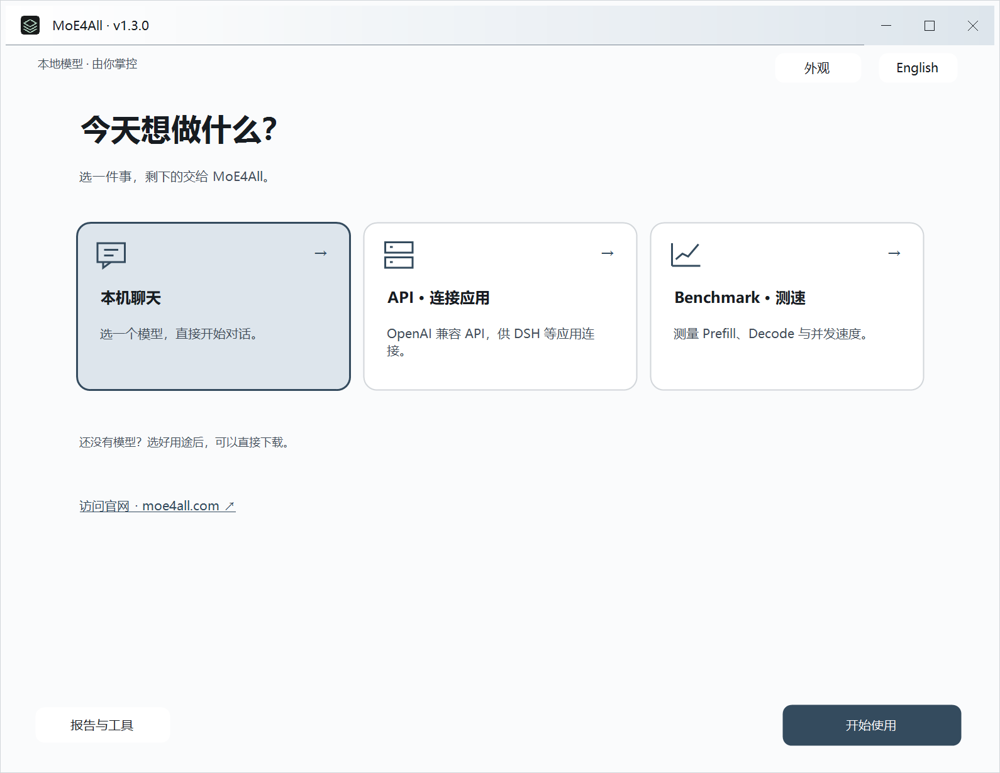

<p align="center">
  <a href="https://moe4all.com/"></a>
</p>

<h1 align="center"><a href="https://moe4all.com/">MoE4All.com</a></h1>

<p align="center"><strong>All-in-one 本地推理引擎：多路 LLM、视觉、Embedding、语音识别与语音合成，高效集成。</strong></p>

<p align="center">约 20 MB · Vulkan 跨设备、跨平台 · 跑起远超显存容量的 MoE 大模型</p>

<p align="center">
  <sub>DSH 接入插件已收录于：</sub><br>
  <a href="https://awesome-dsh-plugin.com/p/Headmaster218/dsh-llm-moe4all/"></a>
  <a href="https://www.dsh.so/zh/artifact/dsh-llm-moe4all/"></a>
  <a href="https://dshmarket.com/p/Headmaster218/dsh-llm-moe4all/"></a>
</p>

<p align="center">
  <a href="https://github.com/Headmaster218/MoE4All/releases/latest"><strong>下载 Engine</strong></a> ·
  <a href="#性能实测">性能实测</a> ·
  <a href="https://moe4all.com/community/">排行榜</a> ·
  <a href="documentation/README.md">开发文档</a> ·
  <a href="RESEARCH.md">理论研究</a> ·
  <a href="README_EN.md">English</a>
</p>

**RX 7900 XTX 24 GB，搭配 64 GB DDR4 内存：**

- **1.3.0 · Qwen3.6 35B 5.91bpw**：6K 上下文，单路 **154.6 tok/s**，四路合计 **248.3 tok/s**。
- **Qwen3.8 Flash-Next 4.27bpw 既有实测**：30K 上下文，单路 **50.44 tok/s**，三路合计 **71.20 tok/s**。

[查看实测条件与完整结果 ↓](#性能实测)

MoE4All 是一个轻量的本地推理引擎。显存、内存与 SSD 三级协同，让 GPU 跑起远超显存容量的 MoE 大模型。解压程序、准备模型，就能在本机聊天，或提供 API 服务。

- **跨设备运行。** Windows、Linux，AMD、NVIDIA、Intel 均已跑通；Apple Silicon 提供实验性 Metal 版本。
- **多个模块，共享资源。** 文本、视觉、Embedding 统一管理 GPU 资源，按需申请与释放；语音转录和合成使用独立 CPU 模块。需要什么就启用什么，也可以单独启动辅助服务。
- **从直接使用到深度配置。** 提供图形向导、命令行、多路生成、会话 KV 持久缓存和 OpenAI 兼容 API；日常使用自动配置，需要时再展开高级设置。

## 下载与启动

### 1. 下载程序，完整解压

打开 [最新发行版](https://github.com/Headmaster218/MoE4All/releases/latest)，下载对应系统的压缩包。**无需额外安装** ROCm、PyTorch 或 CUDA 工具链；GPU 推理需要可用的显卡驱动。

| 系统 | 发行包 | 解压后打开 |
| --- | --- | --- |
| **Windows x86_64** | `MoE4All-Windows-x86_64-v*.zip` | 双击 **`MoE4All Engine.exe`**；经典命令行入口 `Start-INFR-Wizard.cmd` 也保留 |
| **Linux x86_64** | `MoE4All-Linux-x86_64-v*.tar.gz` | `bash Start-INFR-Wizard-Linux.sh` |
| **Apple Silicon** | `MoE4All-macOS-arm64-v*.tar.gz`，实验版 | `zsh Start-INFR-Wizard-macOS.sh` |

### 2. 打开向导，启动引擎

选择用途、模型、计算设备与资源策略，确认后启动。**自动保守**适合后台还有其他程序的情况；**自动激进**会更充分地使用机器资源，优先追求性能。Windows 可以全程在窗口中完成配置和运行：

<p align="center">
  <a href="assets/readme/engine-home-zh-dark.png">
    <picture>
      <source media="(prefers-color-scheme: dark)" srcset="assets/readme/engine-home-zh-dark.png">
      
    </picture>
  </a><br>
  <sub>Windows 原生启动界面，点击查看大图。</sub>
</p>

<details>
<summary>还没有模型？展开推荐模型与组件下载</summary>

向导内可以选择下载位置，也可以导入现有模型。以下主模型与视觉、Embedding、转录组件均提供文件直链。分片模型需下载全部分片，放在同一目录，启动时选择第一片。

| 模型 / 组件 | 用途 | 来源 |
| --- | --- | --- |
| **Qwen3.6 35B APEX-I-Balanced · 5.91bpw** | 日常对话、推理、工具任务 | [下载主模型](https://huggingface.co/mudler/Qwen3.6-35B-A3B-APEX-GGUF/resolve/main/Qwen3.6-35B-A3B-APEX-I-Balanced.gguf?download=true) · [下载视觉 mmproj](https://huggingface.co/mudler/Qwen3.6-35B-A3B-APEX-GGUF/resolve/main/mmproj.gguf?download=true) |
| **Qwen3.8 Flash-Next 4.27bpw** | 大型 MoE 模型与长上下文 | 下载分片 [1](https://huggingface.co/AtomicChat/Qwen3.8-Flash-Next-GGUF/resolve/f5b0b790eebb89033c48091c26abf74c1b385940/Qwen3.8-Flash-Next-AD-4.27bpw-Q4_K_M-M64-00001-of-00003.gguf?download=true) / [2](https://huggingface.co/AtomicChat/Qwen3.8-Flash-Next-GGUF/resolve/f5b0b790eebb89033c48091c26abf74c1b385940/Qwen3.8-Flash-Next-AD-4.27bpw-Q4_K_M-M64-00002-of-00003.gguf?download=true) / [3](https://huggingface.co/AtomicChat/Qwen3.8-Flash-Next-GGUF/resolve/f5b0b790eebb89033c48091c26abf74c1b385940/Qwen3.8-Flash-Next-AD-4.27bpw-Q4_K_M-M64-00003-of-00003.gguf?download=true) · [下载视觉 mmproj](https://huggingface.co/AtomicChat/Qwen3.8-Flash-Next-GGUF/resolve/main/mmproj-Qwen3.8-Flash-Next-F16.gguf?download=true) |
| **Qwen3 Embedding 0.6B Q8_0** | 向量检索与知识库 | [下载模型](https://huggingface.co/Qwen/Qwen3-Embedding-0.6B-GGUF/resolve/main/Qwen3-Embedding-0.6B-Q8_0.gguf?download=true) |
| **SenseVoice Small Q8_0** | 中文、英文等语音转录 | [下载模型](https://huggingface.co/lovemefan/sense-voice-gguf/resolve/main/sense-voice-small-q8_0.gguf?download=true) |
| **MeloTTS Chinese** | 本地语音合成 | 需要原生格式转换，见[模型准备脚本](scripts/convert_melotts_chinese.py)；向导提供对应版本的安装说明 |

引擎还实现了其他 Qwen、Llama、Gemma、Ling、DeepSeek 等模型家族的运行路径。各家族的视觉、KV、MTP 等能力不同，详见[模型运行家族](documentation/architecture/models/runtime-families.md)与[能力矩阵](documentation/reference/model-capabilities.md)。

</details>

<details>
<summary>Linux / macOS 的启动说明</summary>

Apple Silicon 的 Metal 版本仍为实验版，功能覆盖以对应 Release 说明为准。实验包目前尚未 Apple 公证；确认来源后，可对解压目录移除隔离标记：

```sh
xattr -dr com.apple.quarantine /path/to/MoE4All-macOS-arm64-vVERSION
```

[Linux 使用指南](documentation/guide/linux-build-and-run.md)

</details>

## 一个引擎，多种能力

除了运行语言模型，MoE4All 也能为应用提供看图、向量检索与语音能力。模块可以组合启用，Embedding、转录与合成也可以独立运行，无需先加载一个大语言模型。

| 能力 | 用来做什么 | 使用方式 |
| --- | --- | --- |
| **文本与推理** | 对话、推理、工具调用 | 本机聊天或聊天 API，多路请求各有独立 KV |
| **视觉理解** | 图片问答与图文任务 | 在聊天 API 中发送图片，使用配套视觉权重 |
| **Embedding** | 文本检索与知识库 | 独立向量 API，也可与语言模型一起服务 |
| **语音转录** | 将录音转换为文字 | SenseVoice Small，CPU 运行，支持长 WAV 分段处理 |
| **语音合成** | 将文字转换为语音 | 原生 MeloTTS，CPU 运行，需配套模型与语言资源 |

视觉权重按请求加载，Embedding 可在空闲后释放，二者与语言模型共用统一显存管理。这样可以在同一进程中周转资源，而不必为每种能力再起一套长期占用显存的引擎。

语音模块独立管理 CPU 资源，不会额外申请语言模型的显存池。[转录格式与接口说明](crates/infr-audio/README.md) · [语音合成模型准备](scripts/convert_melotts_chinese.py)

## 连接应用与 Agent

### 连接已有客户端

在向导中启动 **API 服务**，把启动后显示的地址填入支持 OpenAI 兼容 API 的客户端。默认 Base URL 为：

```text
http://127.0.0.1:8080/v1
```

模型 ID 从客户端模型列表或 `GET /v1/models` 获取。局域网使用时，在向导中设置监听地址与 API key。

已经在用 **DeepSeek Harness（DSH）**？安装 [MoE4All 接入插件](https://awesome-dsh-plugin.com/p/Headmaster218/dsh-llm-moe4all/)，即可在 DSH 内管理引擎、下载和选择模型、配置推理并查看速度，也可连接已经运行的服务。插件内自动安装引擎目前支持 Windows，其他系统可以连接已有 API。

<details>
<summary>开发者：API 与请求示例</summary>

| 接口 | 用途 |
| --- | --- |
| `POST /v1/chat/completions` | 文本、工具调用与图片请求 |
| `POST /v1/embeddings` | 文本向量 |
| `POST /v1/audio/transcriptions` | WAV 转录，支持分段 SSE 返回 |
| `POST /v1/audio/speech` | 语音合成 |

将 `YOUR_MODEL_ID` 替换为 `/v1/models` 返回的模型 ID。下面是 Bash 示例，Windows 用户也可以直接在客户端中填写 Base URL。

```sh
curl http://127.0.0.1:8080/v1/chat/completions \
  -H 'Content-Type: application/json' \
  -d '{
    "model": "YOUR_MODEL_ID",
    "messages": [{"role": "user", "content": "介绍一下你能帮我做什么。"}],
    "stream": true
  }'
```

</details>

### MoE4All Agent：从对话到工作台

**Engine 负责模型推理，Agent 把模型、工具与插件组织成日常工作环境。** MoE4All Agent 提供桌面工作台、会话和插件引导，可以搭配记忆、定时任务、远程访问等能力。

Agent 当前提供 Windows 桌面版。它使用独立的 `MoE4All.exe` 入口，Engine 与模型可以安装或导入；已有其他客户端也可以继续直接使用引擎。

**[到官网认识 Agent 与插件 →](https://moe4all.com/technical.html#agent)**　[体验网页演示 →](https://moe4all.com/index.html#partner)

## 性能实测

下面是 **RX 7900 XTX 24 GiB · Ryzen 5 5600X · 64 GiB DDR4 · Windows 11** 的实测参考，使用自动激进配置、Q8 K/V，关闭 MTP 与 CPU miss。

**Prefill** 是处理输入的速度，**Decode** 是生成回答的速度。单位均为 tok/s；`x2 / x3 / x4` 表示对应并发下的**合计生成速度**。

| 模型 | 上下文 | Prefill | Decode x1 | Decode x2 | Decode x3 | Decode x4 |
| --- | ---: | ---: | ---: | ---: | ---: | ---: |
| **Qwen3.6 35B Balanced** | 6K | **3,023.5** | **154.6** | 195.3 | 229.4 | 248.3 |
| Qwen3.6 35B Balanced | 30K | **2,988.7** | **125.7** | 152.0 | 180.1 | 192.2 |
| Qwen3.6 35B Balanced | 150K | **1,213.5** | **65.1** | 70.5 | 78.0 | 81.0 |
| **Flash-Next 4.27bpw** | 30K | **1,414.75** | **50.44** | 66.19 | 71.20 | — |
| Flash-Next 4.27bpw | 150K | **1,445.50** | **44.16** | 49.50 | 45.47 | — |

**[打开交互性能页 →](https://moe4all.com/technical.html#engine)**　**[按模型和硬件查排行榜 →](https://moe4all.com/community/)**

<details>
<summary>展开 35B 的前段、中段、后段明细</summary>

Decode 排除每路前 512 个预热 token，正式生成 1,024 token，按 341 / 341 / 342 token 分段。

| 上下文 | 测试 | 前段 | 中段 | 后段 | 总均速 |
| --- | --- | ---: | ---: | ---: | ---: |
| 6K | Decode x1 | 155.1 | 152.5 | 156.2 | 154.6 |
| 6K | Decode x2 | 197.0 | 195.4 | 193.5 | 195.3 |
| 6K | Decode x3 | 232.9 | 231.4 | 224.1 | 229.4 |
| 6K | Decode x4 | 253.2 | 250.2 | 242.0 | 248.3 |
| 30K | Decode x1 | 125.6 | 124.7 | 126.9 | 125.7 |
| 30K | Decode x2 | 153.6 | 154.4 | 148.2 | 152.0 |
| 30K | Decode x3 | 180.7 | 181.3 | 178.2 | 180.1 |
| 30K | Decode x4 | 194.4 | 193.0 | 189.2 | 192.2 |
| 150K | Decode x1 | 65.9 | 62.6 | 67.1 | 65.1 |
| 150K | Decode x2 | 72.4 | 70.8 | 68.4 | 70.5 |
| 150K | Decode x3 | 76.5 | 79.5 | 78.0 | 78.0 |
| 150K | Decode x4 | 80.3 | 80.9 | 81.8 | 81.0 |

</details>

### 看其他硬件，或留下你的结果

[社区排行榜](https://moe4all.com/community/)可以按模型、GPU、内存和上下文筛选实测，查看配置与原始报告；[官网性能图表](https://moe4all.com/technical.html#engine)提供交互展示。

向导内置 **Benchmark**：快速测 6K，标准测 6K / 30K，完整测 6K / 30K / 150K；可选择并发，也可手动安排测试。自动方案每路预热 512 token，正式测 1,024 token，结果展示前、中、后三段和总均速，完整方案每项一次。

测试结束后可以保存本地报告，也可以按引导上传。报告经维护者审核合入后，由 CI 自动更新排行榜数据库。**是否分享由你决定，无需为本地测试注册账号。**

[查看排行榜 →](https://moe4all.com/community/)　[上传已有报告](https://moe4all.com/community/upload.html)　[测量方法](documentation/development/performance/benchmarking.md)

## 显存有限，模型不必

MoE 模型每一步只使用一部分专家。MoE4All 将常用专家留在显存，其余专家按需从 RAM 或 SSD 获取，模型计算仍由 GPU 执行。

<p align="center">
  <a href="https://moe4all.com/technical.html#engine"></a><br>
  <sub>专家流转原理示意。点击打开官网交互演示。</sub>
</p>

<details>
<summary>开发者：资源管理与执行路径</summary>

固定权重与必要控制资源先分配，其余可变化的专家缓存、KV、运行时和辅助模块由统一显存池管理。核显使用共享物理内存，需要合并计算预算，不把“显存容量”和“系统内存容量”当作两份独立资源。

在支持的 GPU 驻留 Decode 路径中，GPU 负责专家驻留与 LRU；可以自行取得的专家由 GPU 搬运，否则通知 CPU 上传。Prefill 则结合分块、专家加载与计算重叠，提高大段输入的处理效率。

</details>

因此，性能不只取决于模型总大小：**激活参数量、量化格式、显存命中率、上下文长度，以及 PCIe / RAM / SSD 的实际速度**都会影响结果。

**[到官网看专家流转动画 →](https://moe4all.com/technical.html#engine)**　[深入阅读资源生命周期](documentation/architecture/memory/runtime-resource-lifecycle.md)

## 文档与开发

| 你关心的内容 | 阅读入口 |
| --- | --- |
| Linux 使用、编译与启动 | [Linux 指南](documentation/guide/linux-build-and-run.md) |
| API、客户端与会话缓存 | [API 快速开始](documentation/guide/serving/api-quickstart.md) · [服务与会话缓存](documentation/architecture/services/server-and-session-cache.md) |
| 配置项与自动资源规划 | [配置参考](documentation/reference/configuration.md) |
| 命中率、资源配比与性能分析 | [理论研究摘要](RESEARCH.md) |
| 调度、并发与显存生命周期 | [并行调度](documentation/architecture/runtime/parallel-scheduler.md) · [资源管理](documentation/architecture/memory/runtime-resource-lifecycle.md) |
| 模型适配与计算路径 | [模型家族](documentation/architecture/models/runtime-families.md) · [代码地图](documentation/architecture/codebase-map.md) |
| 构建、测试与贡献代码 | [源码构建](documentation/development/building-from-source.md) · [开发文档](documentation/development/README.md) |
| Agent 与网站开发 | [Agent 源码](https://github.com/Headmaster218/MoE4All-Agent) · [网站源码](https://github.com/Headmaster218/moe4all-website) |
| 实验与历史数据 | [实测证据](documentation/evidence/README.md) |

[打开完整文档目录 →](documentation/README.md)

## 参与和支持

使用中发现问题，可以提交 [Issue](https://github.com/Headmaster218/MoE4All/issues)。模型名称、运行配置、启动与报错日志，以及可复现步骤，会让定位更快。欢迎贡献适配、测试、文档和有证据的性能优化。

MoE4All 由 **John / Headmaster218** 维护，基于 [kryptic-sh/infr](https://github.com/kryptic-sh/infr) 持续开发。感谢原项目作者、贡献者、上游社区，以及分享实测和问题反馈的用户。

本项目采用 [Apache-2.0](LICENSE)；继承代码与第三方组件的许可和版权信息见仓库中的许可证文件及 [NOTICE](NOTICE)。模型使用各自的许可证。

<a href="https://buymeacoffee.com/headmaster218"></a>

[](https://www.star-history.com/#Headmaster218/MoE4All&Date)
