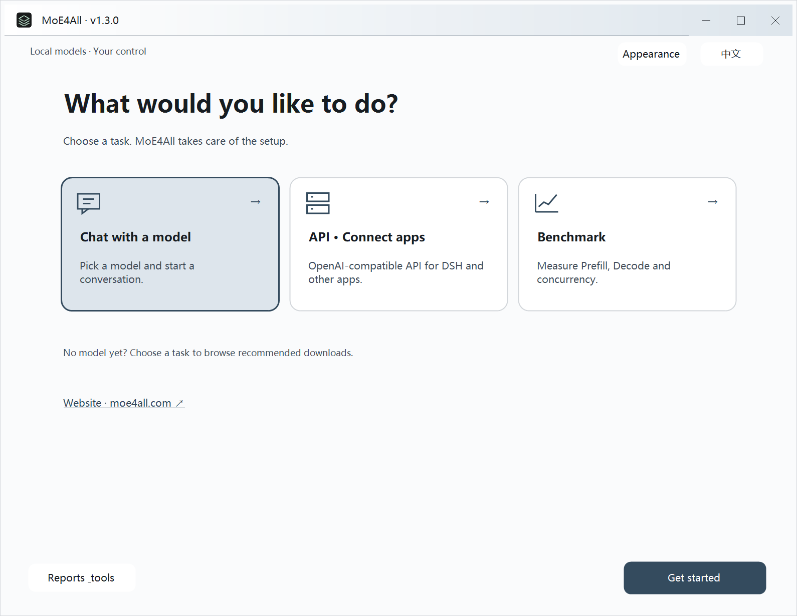
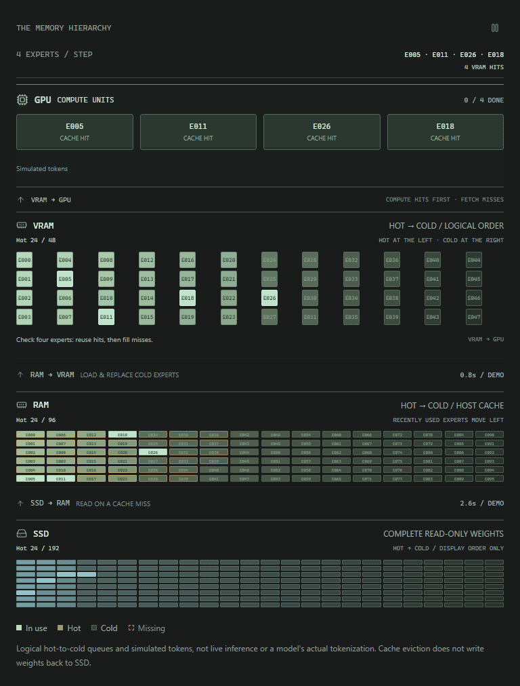

<p align="center">
  <a href="https://moe4all.com/"></a>
</p>

<h1 align="center"><a href="https://moe4all.com/">MoE4All.com</a></h1>

<p align="center"><strong>All-in-one local inference: concurrent LLM serving, vision, embeddings, speech recognition and speech synthesis in one efficient engine.</strong></p>

<p align="center">About 20 MB · Cross-device, cross-platform Vulkan · MoE models far larger than VRAM</p>

<p align="center">
  <sub>The DSH integration plugin is listed in:</sub><br>
  <a href="https://awesome-dsh-plugin.com/p/Headmaster218/dsh-llm-moe4all/"></a>
  <a href="https://www.dsh.so/artifact/dsh-llm-moe4all/"></a>
  <a href="https://dshmarket.com/p/Headmaster218/dsh-llm-moe4all/"></a>
</p>

<p align="center">
  <a href="https://github.com/Headmaster218/MoE4All/releases/latest"><strong>Download Engine</strong></a> ·
  <a href="#measured-performance">Performance</a> ·
  <a href="https://moe4all.com/community/">Leaderboard</a> ·
  <a href="documentation/README.md">Developer docs</a> ·
  <a href="RESEARCH.md">Research</a> ·
  <a href="README.md">简体中文</a>
</p>

**RX 7900 XTX 24 GB, paired with 64 GB DDR4 RAM:**

- **1.3.0 · Qwen3.6 35B 5.91bpw**: **154.6 tok/s** with one stream and **248.3 tok/s** aggregate with four streams at 6K context.
- **Previously measured Qwen3.8 Flash-Next 4.27bpw**: **50.44 tok/s** with one stream and **71.20 tok/s** aggregate with three streams at 30K context.

[See test conditions and full results ↓](#measured-performance)

MoE4All is a lightweight local inference engine. VRAM, RAM and SSD work together to run MoE models far larger than VRAM, with computation on the GPU. Extract the program, prepare a model, and start chatting locally or serving an API.

- **Across devices.** AMD, NVIDIA and Intel have all been tested on Windows and Linux; an experimental Metal package is available for Apple Silicon.
- **Multiple modules, shared resources.** Text, vision and embeddings share GPU resource management, allocating and releasing resources as needed. Transcription and synthesis use independent CPU modules. Enable the capabilities you need, or run an auxiliary service on its own.
- **From automatic setup to detailed control.** A graphical launcher, CLI, concurrent generation, persistent session KV caching and an OpenAI-compatible API are included. Use automatic configuration for everyday work and expand advanced settings when needed.

## Download and start

### 1. Download and fully extract

Open the [latest release](https://github.com/Headmaster218/MoE4All/releases/latest) and select your operating system. **No separate ROCm, PyTorch or CUDA toolchain installation is required.** GPU inference needs a working graphics driver.

| System | Package | Open after extraction |
| --- | --- | --- |
| **Windows x86_64** | `MoE4All-Windows-x86_64-v*.zip` | Double-click **`MoE4All Engine.exe`**; the classic terminal launcher `Start-INFR-Wizard.cmd` is also included |
| **Linux x86_64** | `MoE4All-Linux-x86_64-v*.tar.gz` | `bash Start-INFR-Wizard-Linux.sh` |
| **Apple Silicon** | `MoE4All-macOS-arm64-v*.tar.gz`, experimental | `zsh Start-INFR-Wizard-macOS.sh` |

### 2. Open the launcher and start the engine

Choose a task, model, compute device and resource profile, then confirm to start. **Automatic conservative** suits a machine with other applications running; **automatic aggressive** uses more available resources to prioritize performance. On Windows, configuration and operation stay in the native window:

<p align="center">
  <a href="assets/readme/engine-home-en-dark.png">
    <picture>
      <source media="(prefers-color-scheme: dark)" srcset="assets/readme/engine-home-en-dark.png">
      
    </picture>
  </a><br>
  <sub>Native Windows launcher. Click to enlarge.</sub>
</p>

<details>
<summary>Need a model? Expand recommended models and components</summary>

Choose a download directory in the launcher, or import existing models. The main models, vision, embedding and transcription components below use direct file links. Download every shard of a split model into the same directory and select its first shard to start.

| Model / component | Purpose | Download |
| --- | --- | --- |
| **Qwen3.6 35B APEX-I-Balanced · 5.91bpw** | Chat, reasoning and tool use | [Main model](https://huggingface.co/mudler/Qwen3.6-35B-A3B-APEX-GGUF/resolve/main/Qwen3.6-35B-A3B-APEX-I-Balanced.gguf?download=true) · [Vision mmproj](https://huggingface.co/mudler/Qwen3.6-35B-A3B-APEX-GGUF/resolve/main/mmproj.gguf?download=true) |
| **Qwen3.8 Flash-Next 4.27bpw** | Large MoE models and long context | Shards [1](https://huggingface.co/AtomicChat/Qwen3.8-Flash-Next-GGUF/resolve/f5b0b790eebb89033c48091c26abf74c1b385940/Qwen3.8-Flash-Next-AD-4.27bpw-Q4_K_M-M64-00001-of-00003.gguf?download=true) / [2](https://huggingface.co/AtomicChat/Qwen3.8-Flash-Next-GGUF/resolve/f5b0b790eebb89033c48091c26abf74c1b385940/Qwen3.8-Flash-Next-AD-4.27bpw-Q4_K_M-M64-00002-of-00003.gguf?download=true) / [3](https://huggingface.co/AtomicChat/Qwen3.8-Flash-Next-GGUF/resolve/f5b0b790eebb89033c48091c26abf74c1b385940/Qwen3.8-Flash-Next-AD-4.27bpw-Q4_K_M-M64-00003-of-00003.gguf?download=true) · [Vision mmproj](https://huggingface.co/AtomicChat/Qwen3.8-Flash-Next-GGUF/resolve/main/mmproj-Qwen3.8-Flash-Next-F16.gguf?download=true) |
| **Qwen3 Embedding 0.6B Q8_0** | Vector search and knowledge bases | [Model](https://huggingface.co/Qwen/Qwen3-Embedding-0.6B-GGUF/resolve/main/Qwen3-Embedding-0.6B-Q8_0.gguf?download=true) |
| **SenseVoice Small Q8_0** | Chinese, English and other supported transcription languages | [Model](https://huggingface.co/lovemefan/sense-voice-gguf/resolve/main/sense-voice-small-q8_0.gguf?download=true) |
| **MeloTTS Chinese** | Local speech synthesis | Requires conversion to the native format; see the [preparation script](scripts/convert_melotts_chinese.py) and the version-specific setup instructions linked from the launcher |

The engine also implements other Qwen, Llama, Gemma, Ling and DeepSeek model families. Vision, KV formats, MTP and other capabilities vary by family; see [runtime families](documentation/architecture/models/runtime-families.md) and the [capability matrix](documentation/reference/model-capabilities.md).

</details>

<details>
<summary>Linux / macOS startup notes</summary>

The Apple Silicon Metal package is experimental; check its release notes for supported capabilities. The package is not yet Apple-notarized. After verifying its source, you can remove the quarantine attribute from the extracted directory:

```sh
xattr -dr com.apple.quarantine /path/to/MoE4All-macOS-arm64-vVERSION
```

[Linux guide](documentation/guide/linux-build-and-run.md)

</details>

## One engine, multiple capabilities

Alongside language models, MoE4All can provide vision, vector search and speech services. Combine the modules you need, or run embeddings, transcription or synthesis independently without first loading an LLM.

| Capability | Purpose | Usage |
| --- | --- | --- |
| **Text and reasoning** | Chat, reasoning and tool use | Local chat or chat API; concurrent requests have independent KV caches |
| **Vision** | Image questions and multimodal tasks | Send images through the chat API with a matching vision projector |
| **Embeddings** | Text retrieval and knowledge bases | A standalone vector API or a service alongside the LLM |
| **Transcription** | Convert recordings into text | SenseVoice Small on CPU, with chunked processing for long WAV recordings |
| **Speech synthesis** | Convert text into audio | Native MeloTTS on CPU, with a matching model and language assets |

Vision weights load for requests, and embeddings can unload after an idle timeout. Both share unified VRAM management with the language model, allowing resources to be reused within one process instead of reserving a separate engine's GPU footprint for every capability.

Speech modules manage their CPU resources independently and do not allocate an additional LLM VRAM pool. [Transcription formats and API](crates/infr-audio/README.md) · [Speech model preparation](scripts/convert_melotts_chinese.py)

## Connect applications and agents

### Connect an existing client

Start **API service** in the launcher, then enter the displayed address in a client that supports the OpenAI-compatible API. The default Base URL is:

```text
http://127.0.0.1:8080/v1
```

Get the model ID from the client's model list or `GET /v1/models`. For LAN access, configure the listening address and an API key in the launcher.

Already using **DeepSeek Harness (DSH)**? Install the [MoE4All integration plugin](https://awesome-dsh-plugin.com/p/Headmaster218/dsh-llm-moe4all/) to manage the engine, download and select models, configure inference and view speed inside DSH, or connect to an existing server. Automatic Engine installation from the plugin currently supports Windows; other systems can connect to an existing API.

<details>
<summary>Developers: endpoints and a request example</summary>

| Endpoint | Purpose |
| --- | --- |
| `POST /v1/chat/completions` | Text, tool calls and image requests |
| `POST /v1/embeddings` | Text embeddings |
| `POST /v1/audio/transcriptions` | WAV transcription, with chunked SSE responses |
| `POST /v1/audio/speech` | Speech synthesis |

Replace `YOUR_MODEL_ID` with an ID returned by `/v1/models`. This is a Bash example; Windows users can also enter the Base URL directly in their client.

```sh
curl http://127.0.0.1:8080/v1/chat/completions \
  -H 'Content-Type: application/json' \
  -d '{
    "model": "YOUR_MODEL_ID",
    "messages": [{"role": "user", "content": "Tell me what you can help me with."}],
    "stream": true
  }'
```

</details>

### MoE4All Agent: from chat to a workspace

**Engine runs models; Agent organizes models, tools and plugins into an everyday workspace.** MoE4All Agent provides a desktop workspace, sessions and plugin onboarding, with extensions for memory, scheduled tasks and remote access.

Agent currently ships for Windows. Its separate entry point is `MoE4All.exe`; Engine and models can be installed or imported. Existing clients can continue connecting directly to the engine.

**[Explore Agent and plugins on the website →](https://moe4all.com/technical.html#agent)**　[Try the web demo →](https://moe4all.com/index.html#partner)

## Measured performance

Reference hardware: **RX 7900 XTX 24 GiB · Ryzen 5 5600X · 64 GiB DDR4 · Windows 11**, using the automatic aggressive profile, Q8 K/V, with MTP and CPU miss offload disabled.

**Prefill** measures input processing; **Decode** measures response generation. All speeds are tok/s; `x2 / x3 / x4` are **aggregate throughput** across the active streams.

| Model | Context | Prefill | Decode x1 | Decode x2 | Decode x3 | Decode x4 |
| --- | ---: | ---: | ---: | ---: | ---: | ---: |
| **Qwen3.6 35B Balanced** | 6K | **3,023.5** | **154.6** | 195.3 | 229.4 | 248.3 |
| Qwen3.6 35B Balanced | 30K | **2,988.7** | **125.7** | 152.0 | 180.1 | 192.2 |
| Qwen3.6 35B Balanced | 150K | **1,213.5** | **65.1** | 70.5 | 78.0 | 81.0 |
| **Flash-Next 4.27bpw** | 30K | **1,414.75** | **50.44** | 66.19 | 71.20 | — |
| Flash-Next 4.27bpw | 150K | **1,445.50** | **44.16** | 49.50 | 45.47 | — |

**[Interactive performance charts →](https://moe4all.com/technical.html#engine)**　**[Find results by model and hardware →](https://moe4all.com/community/)**

<details>
<summary>Expand the first, middle and last Decode segments for 35B</summary>

Exclude the first 512 warmup tokens per stream, then measure 1,024 tokens in segments of 341 / 341 / 342 tokens.

| Context | Test | First | Middle | Last | Overall |
| --- | --- | ---: | ---: | ---: | ---: |
| 6K | Decode x1 | 155.1 | 152.5 | 156.2 | 154.6 |
| 6K | Decode x2 | 197.0 | 195.4 | 193.5 | 195.3 |
| 6K | Decode x3 | 232.9 | 231.4 | 224.1 | 229.4 |
| 6K | Decode x4 | 253.2 | 250.2 | 242.0 | 248.3 |
| 30K | Decode x1 | 125.6 | 124.7 | 126.9 | 125.7 |
| 30K | Decode x2 | 153.6 | 154.4 | 148.2 | 152.0 |
| 30K | Decode x3 | 180.7 | 181.3 | 178.2 | 180.1 |
| 30K | Decode x4 | 194.4 | 193.0 | 189.2 | 192.2 |
| 150K | Decode x1 | 65.9 | 62.6 | 67.1 | 65.1 |
| 150K | Decode x2 | 72.4 | 70.8 | 68.4 | 70.5 |
| 150K | Decode x3 | 76.5 | 79.5 | 78.0 | 78.0 |
| 150K | Decode x4 | 80.3 | 80.9 | 81.8 | 81.0 |

</details>

### Explore other hardware, or share your results

The [community leaderboard](https://moe4all.com/community/) lets you filter by model, GPU, RAM and context, inspect configurations and open original reports. The [website charts](https://moe4all.com/technical.html#engine) provide an interactive view.

The launcher includes **Benchmark**: Quick tests 6K input, Standard tests 6K / 30K, and Full tests 6K / 30K / 150K. Choose concurrency or arrange manual tests. Automatic suites exclude 512 warmup tokens per stream and measure 1,024 tokens, reporting first, middle, last and overall speed. Full runs each case once.

Keep the local report or follow the upload guide after testing. Once a report is reviewed and merged, CI updates the leaderboard database. **Sharing is optional; local testing does not require an account.**

[Open leaderboard →](https://moe4all.com/community/)　[Upload an existing report](https://moe4all.com/community/upload.html)　[Measurement methodology](documentation/development/performance/benchmarking.md)

## Limited VRAM. Larger models.

MoE models activate only some experts at each step. MoE4All keeps frequently used experts in VRAM and fetches others from RAM or SSD as needed, while the GPU performs the model computation.

<p align="center">
  <a href="https://moe4all.com/technical.html#engine"></a><br>
  <sub>Illustration of expert flow. Click for the interactive website demo.</sub>
</p>

<details>
<summary>Developers: resource management and execution</summary>

Fixed weights and essential control resources are allocated first. Variable expert caches, KV, runtime workspaces and auxiliary modules are managed through the unified VRAM pool. Integrated GPUs share physical memory with the system, so GPU allocations and system RAM must be budgeted together rather than treated as two independent capacities.

On supported GPU-resident Decode paths, the GPU owns expert residency and LRU management. It copies experts it can access directly and requests CPU uploads otherwise. Prefill overlaps expert loading with computation.

</details>

Performance therefore depends on more than total model size: **active parameters, quantization, cache hit rate, context length, PCIe bandwidth and RAM / SSD speed** all matter.

**[Explore the expert-flow animation →](https://moe4all.com/technical.html#engine)**　[Resource lifecycle details](documentation/architecture/memory/runtime-resource-lifecycle.md)

## Documentation and development

| Topic | Start here |
| --- | --- |
| Linux usage, builds and startup | [Linux guide](documentation/guide/linux-build-and-run.md) |
| APIs, clients and session caching | [API quick start](documentation/guide/serving/api-quickstart.md) · [Serving and session cache](documentation/architecture/services/server-and-session-cache.md) |
| Configuration and automatic budgets | [Configuration reference](documentation/reference/configuration.md) |
| Cache hit rates, resource allocation and performance models | [Research summaries](RESEARCH.md) |
| Scheduling, concurrency and memory lifetimes | [Parallel scheduler](documentation/architecture/runtime/parallel-scheduler.md) · [Resource management](documentation/architecture/memory/runtime-resource-lifecycle.md) |
| Model support and compute paths | [Runtime families](documentation/architecture/models/runtime-families.md) · [Codebase map](documentation/architecture/codebase-map.md) |
| Building, testing and contributing | [Build from source](documentation/development/building-from-source.md) · [Developer guide](documentation/development/README.md) |
| Agent and website development | [Agent source](https://github.com/Headmaster218/MoE4All-Agent) · [Website source](https://github.com/Headmaster218/moe4all-website) |
| Experiments and historical results | [Evidence](documentation/evidence/README.md) |

[Open the full documentation index →](documentation/README.md)

## Contribute and support

Report problems through [Issues](https://github.com/Headmaster218/MoE4All/issues). Include the model, configuration, startup and error logs, and steps to reproduce. Contributions to model support, testing, documentation and evidence-backed performance improvements are welcome.

MoE4All is maintained by **John / Headmaster218**, building on [kryptic-sh/infr](https://github.com/kryptic-sh/infr). Thanks to the original authors, contributors, upstream communities, and everyone sharing measurements and feedback.

The project uses [Apache-2.0](LICENSE). See the repository's license files and [NOTICE](NOTICE) for inherited code and third-party copyrights and licenses. Models retain their own licenses.

<a href="https://buymeacoffee.com/headmaster218"></a>

[](https://www.star-history.com/#Headmaster218/MoE4All&Date)
