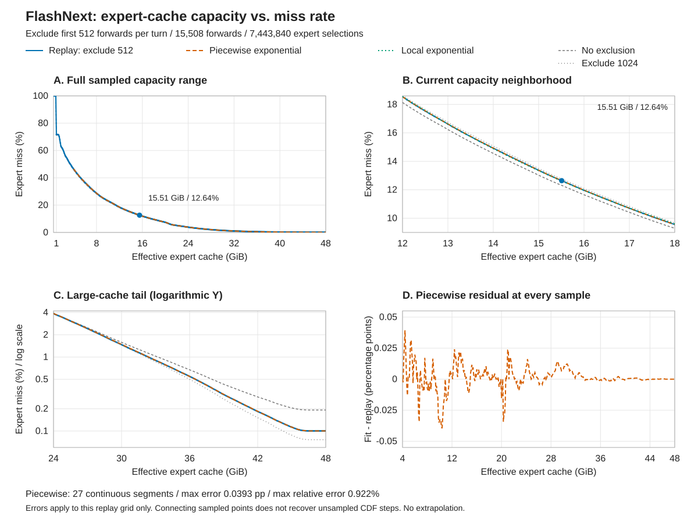
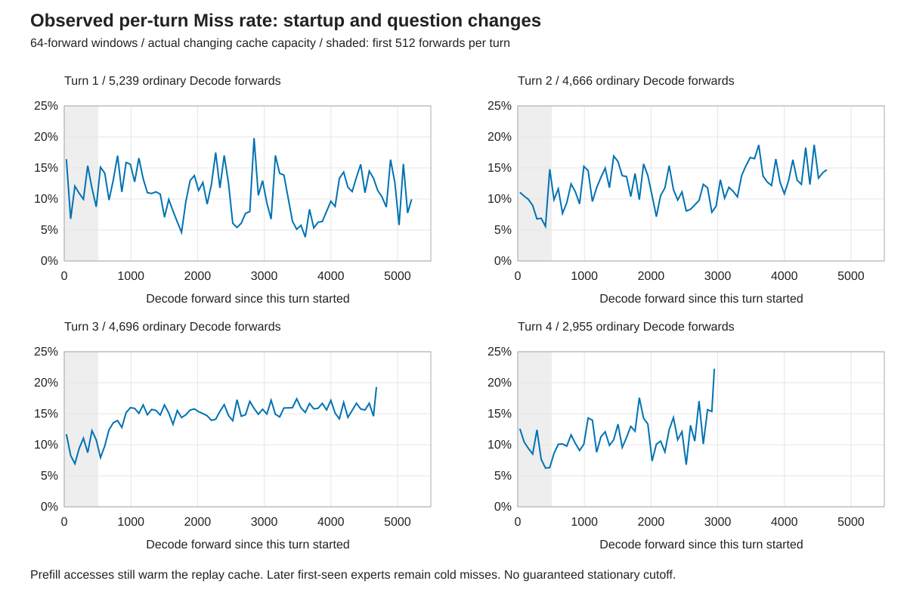

# FlashNext 专家缓存容量与 Miss 率

本页首先回答：**在同一真实工作负载、相同专家池分配比例下，专家缓存变大或被其他资源挤占，Miss 率会如何变化？**
依据四轮自然结束的代码审计、设计与实现问答，记录专家访问顺序后做离线回放。
不是随机填充，不是逐档重新运行模型，也不是开启 MTP 后的实测结果。

在此实测曲线之上，本文还给出一个多卡部署规划公式：输入每张卡可用于专家缓存的显存和实测 PCIe 有效带宽，求使预测专家搬运时间最小的层数比例。该部分是曲线模型推导，不是多卡实机测速。

**主曲线逐轮排除前 512 个普通 Decode forward，所有被排除的访问仍参与缓存热身。**
它是明确的热身后统计口径，不是已经证明所有轮次都进入平稳分布；全程与其他截断长度保留对照。

容量均指 **routed 专家缓存的有效容量，单位 GiB**，不是显卡总容量、手动 VRAM budget 或统一显存 arena 大小。
因此 48 GiB 曲线也不意味着 48 GiB 显卡能给专家留下完整 48 GiB：固定权重、主 KV、MTP、scratch 等仍需占空间。

## 曲线与精度



- **A：完整范围。** 使用全部 476 个回放点，0.5～48 GiB，步长 0.1 GiB；不是先前展示图的稀疏抽样。
- **B：当前容量附近。** 放大 12～18 GiB，并叠加简化的单指数拟合。
- **C：大缓存尾部。** 对数纵轴展示 24～48 GiB，避免低 Miss 区间在线性全图里被压平。
- **D：误差。** 展示分段函数相对每个回放点的误差，单位为百分点。

蓝线与圆点是逐轮排除前 512 个 forward 的离线回放；灰色两条线分别是不排除、逐轮排除前 1024 个 forward。
橙色虚线是下文的连续分段指数函数；绿色点线仅为 12～18 GiB 的简化公式。
回放点之间的连线只是视觉引导，不代表还原了未采样容量处的每个 CDF 台阶。

| 方法 | 容量范围 | R² | 均方根误差，百分点 | 最大绝对误差，百分点 | 最大相对误差 |
| --- | --- | ---: | ---: | ---: | ---: |
| 单指数 | 0.5～48 GiB | 0.980473 | 2.640452 | 23.525534 | 80.161% |
| 单指数 | 4～48 GiB | 0.998190 | 0.493258 | 0.700058 | 227.458% |
| 单指数 | 12～18 GiB | 0.999910 | 0.024808 | 0.044078 | 0.461% |
| **连续分段指数，27 段** | **4～48 GiB** | **0.999999340** | **0.009417** | **0.039342** | **0.922%** |

误差仅针对这份回放的 0.1 GiB 网格。分界点也由同一批数据选择，属于近似曲线的压缩表示，
不是独立工作负载上的预测精度或置信区间。大缓存尾部数值很小，不能只看整体 R²。

## 冷启动与切换问题



此图使用采集的实际 hit flag，专家池容量随 KV 增长变化；不与恒定容量回放混为一谈。
横轴每次换问题重新计数，灰色区域为该轮前 512 个 forward。
通常每窗包含 64 个 forward；末尾不足 64 个的窗口按实际选择数计算，不能把尾端小窗口尖峰当作长期均值。

| 轮次 | 前 64 个 forward | 前 512 个 forward | 排除前 512 后 |
| --- | ---: | ---: | ---: |
| 1，首次请求 | 16.4160% | 11.4941% | 10.9913% |
| 2，换问题 | 11.0645% | 9.3038% | 12.5088% |
| 3，换问题 | 11.7122% | 9.9003% | 15.1880% |
| 4，换问题 | 12.5879% | 9.1964% | 11.6417% |

第一轮最开始确有较高 Miss，但**切换问题后不保证开头 Miss 最大、后面单调改善**。
此前完整 Prefill、缓存沿用与 suffix Prefill 已经触达不少专家；正文阶段的内容分布又会变化。
因此不能把开头一小段当作合理的长时间统计，也不能为了得到更低的 Miss 而挑选窗口。

| 每轮排除的前向数 | 保留 forward | 实际变容量 Miss | 固定参考容量回放 Miss | 48 GiB 回放 Miss |
| ---: | ---: | ---: | ---: | ---: |
| 0，全程 | 17,556 | 12.3223% | 12.3100% | 0.192373% |
| 128 | 17,044 | 12.3630% | 12.3696% | 0.150493% |
| 256 | 16,532 | 12.4511% | 12.4572% | 0.117147% |
| **512，主曲线** | **15,508** | **12.6325%** | **12.6394%** | **0.100365%** |
| 1024 | 13,460 | 12.7500% | 12.7584% | 0.076399% |

所有对照使用同一缓存池比例，全部访问继续推进 LRU；只改变计入统计的分母，
**不重置缓存，也不跳过被排除的访问**。Prefill 一直参与热身，但不计入 Decode Miss 分母。
上述敏感性说明 512 并非统计上证明的收敛点：后段仍会因输出内容变化而改变路由。
后续任务不同或需要严格稳态时，应重新采集，并检查逐轮时间窗与多个热身长度，不直接套用本公式。

## 连续分段函数

令 `C` 为专家缓存有效容量，`M(C)` 为 Miss **百分数**，例如 `12.36` 表示 `12.36%`。
在表中找到 `C_i <= C <= C_{i+1}` 的一段，计算：

```text
M(C) = A_i * exp(-k_i * (C - C_i))
```

`A_i` 是该段起点的回放百分数；`k_i` 的单位为 `GiB^-1`。
两端值来自回放，因此相邻段连续，且整个函数单调不增；不会在分界处凭空增加或减少 Miss。

| `C_i` | `C_{i+1}` | `A_i`，百分数 | `k_i`，GiB^-1 |
| ---: | ---: | ---: | ---: |
| 4.0 | 5.0 | 46.505459548 | 0.123944825064 |
| 5.0 | 6.3 | 41.084252214 | 0.116890420744 |
| 6.3 | 7.0 | 35.292389412 | 0.123218721668 |
| 7.0 | 8.7 | 32.375897386 | 0.119433211885 |
| 8.7 | 9.1 | 26.426777040 | 0.106777947736 |
| 9.1 | 10.9 | 25.321823145 | 0.100202293999 |
| 10.9 | 12.1 | 21.142864436 | 0.119371394801 |
| 12.1 | 14.2 | 18.321162196 | 0.107743088107 |
| 14.2 | 16.6 | 14.611316202 | 0.110668996717 |
| 16.6 | 18.3 | 11.203102162 | 0.113287622316 |
| 18.3 | 19.3 | 9.240553263 | 0.124198478297 |
| 19.3 | 19.9 | 8.161298470 | 0.129507242438 |
| 19.9 | 20.2 | 7.551142958 | 0.173245939109 |
| 20.2 | 20.8 | 7.168705937 | 0.254396617691 |
| 20.8 | 21.2 | 6.153907123 | 0.216790799428 |
| 21.2 | 23.1 | 5.642746217 | 0.126909970210 |
| 23.1 | 24.8 | 4.433733127 | 0.150903311143 |
| 24.8 | 27.2 | 3.430500924 | 0.158625797521 |
| 27.2 | 34.6 | 2.344341093 | 0.164504222162 |
| 34.6 | 36.5 | 0.693969779 | 0.170986614623 |
| 36.5 | 39.6 | 0.501475045 | 0.188588783403 |
| 39.6 | 43.7 | 0.279479408 | 0.172507896520 |
| 43.7 | 44.8 | 0.137778351 | 0.156504548223 |
| 44.8 | 45.5 | 0.115988522 | 0.134173272417 |
| 45.5 | 45.9 | 0.105590663 | 0.087716940048 |
| 45.9 | 46.5 | 0.101950069 | 0.026118285714 |
| 46.5 | 48.0 | 0.100364865 | 0.000000000000 |

表中系数为显示精度；[机器可读结果](assets/2026-10-11-flashnext-expert-cache/fit-summary.json)保留完整精度。
不得外推到 4 GiB 以下或 48 GiB 以上。0.5～4 GiB 保留原始回放点：其中存在明显平台和跳变，
例如 0.9 GiB 与 1.0 GiB 之间的跳变，不宜用平滑指数描述。
本回放也没有验证这些极低容量能通过真实引擎的物理分配与最小工作集检查。

### 只估算本机当前容量附近

12～18 GiB 可使用更短的单指数，不必查完整分段表：

```text
M(C) ~= 12.622897867 * exp(-0.109759339421 * (C - 15.508289579))
```

仅限 12～18 GiB，最大误差 0.044078 个百分点。它是最小二乘拟合，
没有被强制经过参考容量的原始回放点；不要将其外推到大缓存尾部。

## 关键容量点

以下为回放值，不是分段函数的预测值：

| 专家缓存有效容量 | 专家 Miss 率 |
| ---: | ---: |
| 4 GiB | 46.505460% |
| 8 GiB | 28.738245% |
| 12 GiB | 18.538295% |
| 15.5 GiB | 12.649869% |
| 16 GiB | 11.964322% |
| 18 GiB | 9.558427% |
| 24 GiB | 3.860306% |
| 32 GiB | 1.061294% |
| 40 GiB | 0.261303% |
| 48 GiB | 0.100365% |

主曲线在 46.5～48 GiB 已达到所选窗口的首次访问下限：`7,471 / 7,443,840 = 0.100365%`。
这些是观测序列中尚无先前访问可供复用的专家，不是稳定阶段仍因容量不足而反复换出的专家。
回放没有假设所有未来专家一开始已经常驻，也没有用这个下限预测完整预加载后的实机 Miss。

## 多卡层数配比

同一条曲线也可以写成命中率 `H(C) = 100% - M(C)`。多卡规划直接使用 Miss 率更方便：在 Decode 计算不是瓶颈、专家搬运主导耗时的近似下，应让新增一层所带来的传输成本尽量小，而不是简单按显存容量或 `显存 x PCIe 带宽` 分层。

设第 `i` 张 GPU 可用于 **routed 专家缓存** 的显存为 `V_i` GiB，实测专家小块传输的有效 PCIe 带宽为 `B_i`，分配到的模型层数比例为 `r_i`；`E` 是目标模型全部 routed 专家权重大小，单位 GiB。基于本页 FlashNext 曲线的最优比例为：

$$
\mathbf{r}^{*}=
\underset{r_i\ge 0,\ \sum_i r_i=1}{\operatorname{argmin}}
\sum_{i=1}^{G}
\frac{r_i}{B_i}
M\!\left(\frac{49.22\,V_i}{E\,r_i}\right)
$$

其中 `49.22 GiB` 是本次 FlashNext 模型完整 routed 专家权重的近似大小，用于把其他模型的“每层可用缓存比例”映射回本页曲线的横轴。`M(x)` 使用上面的完整分段 Miss 曲线，百分数或小数口径均可，只要各卡一致。`r_i = 0` 的卡不参与求和；若 `V_i >= E r_i`，该卡负责的 routed 专家可以全部常驻，稳态搬运项直接记为 0，不把曲线外的容量继续外推。

公式的输入在模型固定后实际只有两类硬件量：

- `V_i`：扣除固定权重、KV、scratch 等以后，真正能留给专家缓存的显存；不是显卡标称 VRAM。
- `B_i`：按实际专家块大小测出的有效传输带宽；不是 PCIe 代际与通道数的理论峰值。

输出 `r_i` 就是各卡层数比例。若模型共有 `N` 层，最终取整数 `n_i`，使 `n_i` 接近 `N r_i` 且 `sum(n_i) = N`。由于 `M(x)` 是分段非线性的，实际程序直接枚举整数层数或用动态规划求解即可，不需要闭式近似。

### 两卡示例

假设两张卡都能留下 `20 GiB` 专家缓存，有效 PCIe 带宽比例为 `16:4`；目标模型有 100 层，routed 专家权重合计 `100 GiB`。用完整曲线枚举整数层数，预测最优分配为 **67:33**：快 PCIe 卡承担 67 层，慢 PCIe 卡承担 33 层。

| x16 / x4 层数 | 相对预测传输代价 |
| ---: | ---: |
| 50 / 50 | 1.000 |
| 59 / 41 | 0.663 |
| **67 / 33** | **0.581** |
| 70 / 30 | 0.592 |
| 80 / 20 | 0.738 |

以上代价归一化到 50:50，表示现有 Miss 曲线下的模型预测，**不是实际多卡测速**。慢 PCIe 卡分到较少层后，每层可用专家缓存更多，Miss 率更低；但分得过少又会把快卡的缓存摊薄，因此最优点通常不会等于显存比例、带宽比例或两者的简单乘积。

这个公式只优化预测专家搬运时间，暂未计入 GPU 计算、跨卡 hidden-state 传输、同步、拓扑竞争、冷启动和不同专家块大小。并发、MTP 或其他模型会改变访问曲线；正式自动分层前，应使用对应工作负载重新标定 `M(x)` 和 `B_i`。若固定权重与 KV 随层数变化明显，可在枚举每个候选比例时把 `V_i` 改为 `V_i(r_i)`，优化框架不变。

## 来源与配置

- 采集时间：2026-10-11，16:12:48～16:23:17，Asia/Shanghai。
- 运行 ID：`natural-pager-trace-20261011/2026-10-11T08-12-47-971Z`。
- 源码 HEAD：`83fef5cedfad6af64ec259a22cc9bc61427caa38`。
- 二进制 SHA-256：`9b6c092bf950400a93472cc50367fa4269323e99bead65c7731449cebdfd9a5d`。
- 原始访问 CSV SHA-256：`446b6a550c84f2eeac562ef501d1a455d43c03104effd94971511e71ed4dd955`；25,863,840 行，1,172,758,062 字节。
- 硬件：RX 7900 XTX 24 GiB、Ryzen 5 5600X、64 GiB RAM、Windows 11。
- 模型：`Qwen3.8-Flash-Next-AD-4.27bpw-Q4_K_M-M64`，33 个 GGUF 分片。
- 生效配置：真正单槽单路；激进自动资源策略，额外 VRAM reserve 为 0，RAM budget 为 48 GiB，`ubatch=4096`。
- Q8_0 K/V，上下文容量 163,840；MTP、视觉、Embedding、专家预取、CPU miss、KV overflow 和 SSD 会话缓存均关闭。
- `temperature=0`、`seed=1`、关闭思考；每轮安全输出上限 32,768 token，四轮均自然停止，没有强制续写。
- 编译：默认 release，未启用 `expert-diagnostics`；启动时工作区包含 Vulkan 诊断实验的未提交修改。
  当时的状态与 diff 保存在本机工件中；不把这些并发编辑一概视为已进入实测二进制。
- 模型未计算完整文件 SHA-256；原始 manifest 保存分片大小、时间戳和第一片前 16 MiB 的 header hash。

四轮合计生成 17,560 token，上下文从 42,099 增长到 59,979。
排除 Prefill，以及**每一轮**前 512 个 Decode forward 后，保留 15,508 个 forward，
每次 48 层、每层 10 个专家，合计 7,443,840 次逻辑专家选择。
第五轮在用户要求停止后被中止，完全不纳入本曲线。

实际专家容量随主 KV 增长，从约 15.608 GiB 降到 15.373 GiB。
按主曲线保留 forward 数加权，参考容量为 15.508289579 GiB；原始变容量运行的专家 Miss 为 12.632485%，
改成恒定参考容量的回放为 12.639364%。二者口径不同，不应强行拟合成相同数值。

## 回放方法

专家的 Gate / Up / Down 任一块缺失即记为一次**逻辑专家 Miss**。
这不是单个角色块 Miss、KV 缓存未命中、缺失字节比例，或 GPU 暴露等待时间。

兼容块大小的三个共享池分别为 524,800 / 704,000 / 921,600 字节。
每个容量使用相同的参考池比例，不重新优化分配：

```text
slots[p](C) = floor(meanSlots[p] * C / referenceGiB)
```

对池内复用距离为 `D` 的块，命中条件为 `D < slots[p]`。
该块的最小有效容量为 `(D + 1) * referenceGiB / meanSlots[p]`；
一个逻辑专家的临界容量取三个角色块的最大值。
累计临界容量直方图即可查询任意容量的经验 Miss 率：

```text
M_exact(C) = 100 * (1 - count(expert critical capacity <= C) / selections)
```

重新读取完整访问记录，分别汇总每轮 0/128/256/512/1024 的截断口径。
40～48 GiB 直接查询对应窗口的复用距离直方图，**不是外推 40 GiB 以内的拟合函数**。
每种口径保留 476 个容量点，缓存池比例始终相同。
按原始每轮真实池容量回放，主曲线的 22,331,520 个角色块 hit flag 与采集结果完全一致，零分歧。
这证明本样本在声明的访问顺序和池模型下复现正确，不证明改变策略后的执行顺序仍相同。

分段生成器从 4～48 GiB 两端的指数插值开始，递归在误差最大的网格点分段。
停止条件同时要求最大绝对误差不超过 0.05 个百分点、最大相对误差不超过 1%。
系数不是互不相关的独立拟合，所有段共享相邻的回放端点，因而连续且单调。

## 限制与用途

- 这是单路普通 Decode、约 42K～60K 上下文、四轮真实任务的固定访问序列；不是所有提示词、上下文或并发数的通用公式。
- 大容量仍使用同一比例的三个缓存池，不假设容量足够时能随意合并池或预先加载全部专家。
- 首次观察到的访问仍是 Miss；未知初始常驻和完整预加载行为不能由此独立还原。
- 未知初始 LRU 在原始序号 125,349 处经足够不同块的访问被洗出；主曲线的每轮 512 截断位于该点之后。零截断曲线仅是含冷启动的回放对照，不声称其初始状态与实际启动时完全一致。
- MTP 会增加自己的 draft / verify 专家访问并改变接受过程。本曲线只能估算**缓存容量缩小这一项**，不能当作 MTP 实际 Miss 率或速度。
- 记录 CSV 会扰动 CPU 时间。本页不使用本次采集速度宣称性能提升，也不把 Miss 变化直接等同于 tok/s 变化。
- 图、公式和误差适用于当前回放网格；需更精确的任意容量查询时，使用完整临界容量 CDF，而不是继续提高多项式阶数。

## 数据与复现

- [全部容量点与来源信息](assets/2026-10-11-flashnext-expert-cache/curve-data.json)
- [分段系数与误差统计](assets/2026-10-11-flashnext-expert-cache/fit-summary.json)
- [原尺寸矢量图](assets/2026-10-11-flashnext-expert-cache/capacity-miss-curve.svg)
- [逐轮热身与切题时间窗](assets/2026-10-11-flashnext-expert-cache/warmup-miss-rate.svg)
- [生成器](assets/2026-10-11-flashnext-expert-cache/generate.cjs)与[单元测试](assets/2026-10-11-flashnext-expert-cache/generate.test.cjs)

从仓库根目录执行，只需 Node.js 22 或更新版本，不需要模型、GPU 或第三方 npm 包：

```sh
node documentation/evidence/benchmarks/assets/2026-10-11-flashnext-expert-cache/generate.cjs
node --test documentation/evidence/benchmarks/assets/2026-10-11-flashnext-expert-cache/generate.test.cjs
```

生成器复现已发布容量点上的分段函数、统计和 SVG；它不重新采集模型，也不重建原始 CDF。
完整日志、提示词、1.17 GB 访问 CSV、原始 manifest 和临界容量 CDF 留在本机忽略的 `benchmark-data/`。
仓库仅保存必要的汇总数据、溯源信息和可复现图表；本次未新增或清理任何 KV 缓存。
